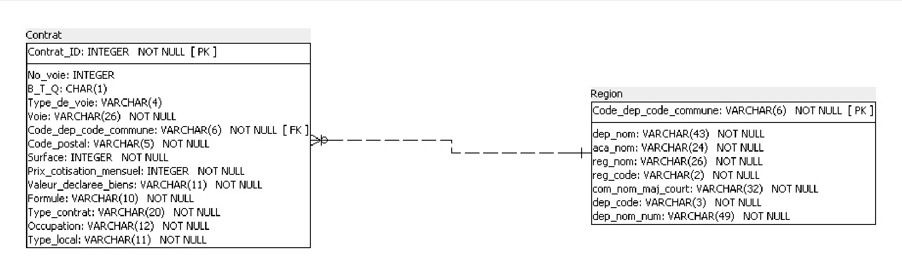

# Création et interrogation d'une base de données d'assurance habitation

> Projet du parcours **Business Intelligence Analyst** (OpenClassrooms), réalisé dans une mise en situation professionnelle.
> **Outils :** SQL · SQLite / SQLiteStudio · SQL Power Architect · Excel

## Objectif

Transformer deux fichiers CSV d'un assureur en une **base de données relationnelle fiable**, puis l'interroger en SQL pour répondre à des questions métier.

## Données sources

| Fichier | Volume | Contenu |
|---|---|---|
| `Contrat.csv` | 30 335 lignes, 14 colonnes | Contrats : logement, adresse, formule, cotisation |
| `Region.csv` | 38 916 lignes, 8 colonnes | Référentiel géographique : commune, département, académie, région |

La clé de liaison entre les deux fichiers est `Code_dep_code_commune`.

## Démarche

1. **Exploration :** analyse des volumes, des colonnes, des types et de la clé de liaison.
2. **Dictionnaire de données :** type, taille, description et rôle de chaque colonne. Par exemple, le code postal est stocké en `VARCHAR(5)` pour conserver les zéros initiaux.
3. **Modélisation :** schéma relationnel conçu dans SQL Power Architect, avec 2 tables reliées par une clé étrangère. Cette séparation évite de répéter les données des communes.
4. **Création et import :** import via des tables temporaires pour contrôler l'ordre des colonnes. J'ai corrigé **9 contrats au code commune invalide** avant le chargement final.
5. **Contrôle d'intégrité :** `PRAGMA foreign_key_check` ne renvoie aucune ligne, donc **0 erreur de clé étrangère**.
6. **Analyses SQL :** 12 requêtes métier.

## Quelques résultats

| Question | Résultat |
|---|---|
| Prix moyen de la cotisation mensuelle | 19,33 € |
| Contrats sur des résidences principales | 25 620 |
| Formules Integral en Pays de la Loire | 589 |
| Surface moyenne des logements assurés à Paris | 51,77 m² |
| Région avec le plus de contrats | Île-de-France (14 177) |
| Communes avec au moins 150 contrats | 20 |

## Compétences SQL mobilisées

`CREATE TABLE` · clés primaires et étrangères · `NOT NULL` · `WHERE` · `DISTINCT` · `COUNT` / `AVG` / `ROUND` · `ORDER BY` / `LIMIT` · `JOIN` · `GROUP BY` / `HAVING`

## Contenu du dépôt

| Fichier | Description |
|---|---|
| `01_creation_tables.sql` | Script de création des tables (généré avec SQL Power Architect, adapté pour SQLite) |
| `dictionnaire_donnees.xlsx` | Dictionnaire de données des 2 tables (types, tailles, clés, descriptions) |
| `02_requetes_analyse.sql` | Les 12 requêtes d'analyse |
| `schema_relationnel.png` | Schéma relationnel |
| `document_technique.pdf` | Exploration, dictionnaire, modélisation et contrôles |
| `requetes_sql.pdf` | Les requêtes avec leurs résultats et leurs explications |
| `presentation.pdf` | Présentation de la méthodologie et des résultats |

*Les fichiers CSV sources et la base de données ne sont pas publiés.*

## Auteur

**Antony Labandibar**, en formation Business Intelligence Analyst. Je recherche un stage BI / Data Analyst en avril-mai 2027 (Seine-et-Marne).
[LinkedIn](https://www.linkedin.com/in/antony-labandibar) · Autres projets : [SportDataPulse](https://github.com/Antony-Labandibar/sportdatapulse-ligue1-sql) · [Conformité RGPD d'un CRM](https://github.com/Antony-Labandibar/rgpd-anonymisation-crm)
